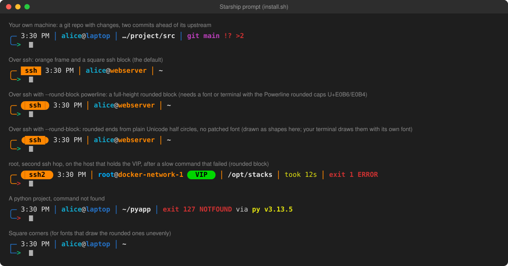
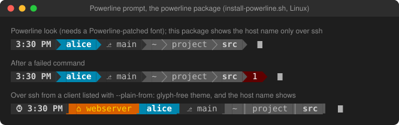
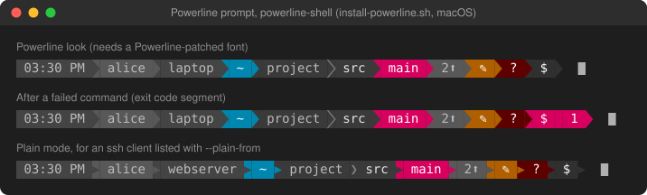

# shell-prompt-setup

A better prompt for **zsh and bash**, installed with one command on Debian/Ubuntu or macOS. Pick one of two looks, and optionally add a
friendlier zsh (autosuggestions, syntax highlighting, smarter Tab completion, history):

| | You get | Needs a special font? |
|---|---|---|
| **Starship prompt** (default) | A clean two-line prompt: clock, user@host, folder, git status with ahead/behind counts, command time and exit status. Over ssh the frame turns orange and a block shows how many ssh hops deep you are. | **No.** Plain characters only, so it looks right in a browser terminal too. |
| **Powerline prompt** | The classic arrow-segment look, with colored blocks. | **Yes**, a Powerline-patched font in the terminal you look at (with a glyph-free fallback for ssh clients that have none). |
| **zsh setup** (optional, zsh only) | History, completion, plugins, key bindings. | No. |

## What the prompts look like

Every picture below is **real output**, captured from the installed prompts (the clock, host and user names are fixed for the screenshots).
Each prompt has a color image of every situation, and the first one again as plain text for readers without color (all of them are in `docs/images/*.txt`).

### Starship prompt



<!-- examples:starship -->

**Your own machine: a git repo with changes, two commits ahead of its upstream**, as plain text:

```text
╭─ 3:30 PM │ alice@laptop │ …/project/src │ git main !? >2
╰─>
```

All the situations in the picture, as plain text: [docs/images/starship.txt](docs/images/starship.txt).

<!-- /examples:starship -->

Reading line 1, left to right:

| Part | Meaning |
|---|---|
| `╭─` ... `╰─>` | The frame. Green on your own machine, **orange** in an ssh session. `┌─ └─` (square) where a font draws the rounded corners unevenly. |
| `ssh` / `ssh2` / `ssh3` | Only in an ssh session: a black-on-orange block. `ssh2` means you ssh'd again from an ssh session. With `--round-block` its ends are rounded (`◖ ssh ◗`, or full-height with `--round-block powerline`). |
| `3:30 PM` | The clock. |
| `alice@laptop` | User (cyan; **gold** if the user is in the `sudo`, `wheel`, `admin` or `docker` group; **magenta for root**) and host (the frame color: green locally, orange over ssh). |
| `VIP` | A green block: this host currently holds a floating address you configured (keepalived and the like). Rounded the same way as the `ssh` block with `--round-block`. |
| `project/src` | Folder, up to 6 levels, `…/` when shortened. |
| `git main !? >2` | Branch; `!` modified, `+` staged, `?` untracked, `x` deleted, `$` stash, `=` conflicts; `>2` two commits ahead of the upstream, `<3` three behind, `> <3` both. A count shows only above 1. |
| `took 12s`, `exit 1 ERROR` | Only when relevant: a slow command, or the last command failed. |
| `via py v3.13.5` | Language versions, only inside a real project (`pyproject.toml`, `package.json`, `go.mod`, ...). |

### Powerline prompt

On Linux this is the `powerline` package; on macOS it is [powerline-shell](https://github.com/b-ryan/powerline-shell) with the same idea.
The **patched font** is what draws the arrow separators; without one they show as empty boxes.



<!-- examples:powerline -->

**Powerline look (needs a Powerline-patched font); this package shows the host name only over ssh**, as plain text:

```text
 3:30 PM ▶ alice ▶ ⎇ main ▶ ~ › project › src ▶
```

All the situations in the picture, as plain text: [docs/images/powerline.txt](docs/images/powerline.txt).

<!-- /examples:powerline -->



<!-- examples:powerline-shell -->

**Powerline look (needs a Powerline-patched font)**, as plain text:

```text
 03:30 PM ▶ alice ▶ laptop ▶ ~ ▶ project › src ▶ main ▶ 2⬆ ▶ ✎ ▶ ? ▶ $ ▶
```

All the situations in the picture, as plain text: [docs/images/powerline-shell.txt](docs/images/powerline-shell.txt).

<!-- /examples:powerline-shell -->

In the plain-text versions `▶` stands for the arrow glyph and `⎇` for the branch icon. For ssh clients you list with `--plain-from`, the prompt
switches to a glyph-free theme (the third picture in each set), so a browser terminal without a Powerline font still looks right.

## Start from scratch

### 1. What you need

- **Linux (Debian or Ubuntu)** or **macOS**, with bash or zsh. On macOS you also need [Homebrew](https://brew.sh) (it installs `starship`, and the zsh plugins).
- To set up other users on a server, run the installer as root (`sudo`). On a Mac run it as yourself (Homebrew refuses root).
- `curl`. For the Powerline look you want a Powerline-patched font in your terminal (step 4).

### 2. Pick a prompt and install it

The installer looks at your login shell (zsh or bash) and sets that one up. For **Starship**:

```bash
curl -fsSL https://raw.githubusercontent.com/rodneyshupe/shell-prompt-setup/main/install.sh | bash
```

For **Powerline** instead:

```bash
curl -fsSL https://raw.githubusercontent.com/rodneyshupe/shell-prompt-setup/main/install-powerline.sh | bash
```

If your login shell is zsh you also get the zsh setup. Useful variations (they work with both installers, add them after `bash -s --`):

```bash
# see what it would do first; changes nothing
curl -fsSL https://raw.githubusercontent.com/rodneyshupe/shell-prompt-setup/main/install.sh | bash -s -- --dry-run

# only the prompt: nothing else in your zsh is touched
curl -fsSL https://raw.githubusercontent.com/rodneyshupe/shell-prompt-setup/main/install.sh | bash -s -- --prompt-only

# set up zsh and bash, not just your login shell
curl -fsSL https://raw.githubusercontent.com/rodneyshupe/shell-prompt-setup/main/install.sh | bash -s -- --shells both

# several users on a server, and make zsh their login shell
curl -fsSL https://raw.githubusercontent.com/rodneyshupe/shell-prompt-setup/main/install.sh | sudo bash -s -- --users root,alice,bob --shell
```

> Piping a script from the internet into a shell runs whatever is there. Read [`install.sh`](install.sh) first, clone the repo and run it
> (`git clone https://github.com/rodneyshupe/shell-prompt-setup && cd shell-prompt-setup && ./install.sh --help`), or use `--dry-run`.

### 3. Open a new terminal and check

Open a new terminal window (or run `exec zsh` / `exec bash`). You should see the two-line prompt from the pictures above. To be sure which prompt is
active:

```bash
echo $STARSHIP_SHELL      # Starship prompt: prints zsh or bash
echo $SPS_PROMPT          # Powerline prompt: prints powerline or powerline-shell
```

If something looks wrong, `install.sh --uninstall` puts everything back (step 5).

### 4. Fonts (Powerline only)

The Starship prompt needs nothing. Powerline needs a Powerline-patched font **in the terminal you look at** (not on the server):

- **macOS:** add `--fonts` to the Powerline install (it installs *Meslo LG for Powerline*), then pick that font in Terminal or iTerm2 → Preferences → Profiles → Text.
- **Linux or another machine:** install a Powerline font on the machine you sit at (for example `fonts-powerline` on Debian/Ubuntu, or any Nerd Font) and select it in the terminal.
- **A terminal that cannot do it** (a browser terminal, say): list the addresses it connects from with `--plain-from 192.168.1.20` and those ssh sessions get the glyph-free theme.

### 5. Tune, switch, undo

- **Per-machine settings** live in `~/.config/shell-prompt-setup/settings.sh`: `--vip ADDRESS` (the green VIP block), `--round-block` (rounded ends on the ssh block), `--square-from IP[,IP]` (square corners
  for those ssh clients), `--plain-from IP[,IP]` (glyph-free Powerline), or set `PROMPT_CORNERS=square` / `PROMPT_PLAIN=1` there for everywhere.
- **Switch prompts** by running the other installer: both write the same single block in `~/.zshrc` / `~/.bashrc`, so you never get two prompts.
- **Update** by re-running the installer. Files you edited in `~/.config/shell-prompt-setup/` are kept and reported; add `--force` to replace them (a backup is kept).
- **Undo** everything with `install.sh --uninstall` (or `install-powerline.sh --uninstall`; add `--users` for other users). That removes the marked blocks and
  `~/.config/shell-prompt-setup/`. Packages and your login shell are left as they are; `chsh -s /bin/bash <user>` goes back to bash.

## If you already have a zsh or bash setup

**Nothing of yours is replaced.** The installers never overwrite `~/.zshrc` or `~/.bashrc`: they append a short marked block (`# >>> shell-prompt-setup: prompt >>>` ...
`# <<< ... <<<`) that sources their own files, and the first time they touch a file they keep a backup as `<file>.bak.<timestamp>`. Your aliases, `PATH` changes,
nvm/pyenv lines and so on stay where they are.

- **Use `--prompt-only` if you already have a zsh setup** (history, completion, plugins), so a second `compinit`, plugin or key-binding block cannot fight with yours.
- If your config sets its own prompt (Oh My Zsh `ZSH_THEME`, Powerlevel10k, `PS1=` / `PROMPT=`, another `starship init`), remove that: two prompts fight. The new block is
  appended at the end, so it normally wins.
- Your own `~/.config/starship.toml` and `~/.config/powerline*` are not touched: this project keeps its config in `~/.config/shell-prompt-setup/`.
- A `~/.bashrc` or `~/.zshrc` that already loads **another prompt by hand** (Powerline, powerline-shell, a `starship init`) is refused by both installers, because two prompts fight over `PS1`; the message says which lines. `--force` removes the two standard snippets it recognises, the Debian `# Powerline configuration` block and the powerline-shell `_update_ps1` snippet (after a backup). A hand-written `starship init` or anything else you have to remove yourself.
- macOS terminals start login shells, so the bash block goes into `~/.bash_profile` (or the first of `~/.bash_login`, `~/.profile` that exists). Linux: `~/.bashrc`.
- Coming from an older version of this project? See [docs/upgrading.md](docs/upgrading.md).

## Options

Shared by `install.sh` and `install-powerline.sh`:

| Option | What it does |
|---|---|
| `--users u1,u2` | Users to set up. Default: whoever runs the script. Other users than yourself need root. |
| `--shells WHICH` | `auto` (default): each user's login shell, zsh or bash. `zsh` or `bash`: that one. `both`: zsh and bash. A login shell that is neither (fish, sh, ...) is reported and skipped unless you pass this. |
| `--prompt-only` | Only the prompt. No zsh setup, no plugins. |
| `--shell` | Make zsh the login shell (`chsh`) and set zsh up for the user, only after a zsh login test passed. |
| `--uninstall` | Remove the marked blocks and `~/.config/shell-prompt-setup`. Packages and login shells are left as they are. |
| `--ssh-agent` | Add a block that starts an ssh-agent with `~/.ssh/github*.key` unless one is already available (e.g. forwarded) and stops only an agent it started. |
| `--no-packages` | Only place the files, install nothing. |
| `--force` | Replace files in `~/.config/shell-prompt-setup` that differ from this repo's (the old one is kept as `<file>.bak.<timestamp>`). |
| `--dry-run` | Print what would happen, change nothing. |
| `--base-url URL` | Where to download the files from when not run from a clone (for forks or a mirror). |

Only `install.sh` (Starship):

| Option | What it does |
|---|---|
| `--vip ADDRESS` | Show a green `VIP` block after the host name while this host holds `ADDRESS` (keepalived, HA pairs). It rounds the same way as the `ssh` block (`--round-block`), and stays square for `--square-from` clients. |
| `--square-from IP[,IP...]` | Square corners (`┌─ └─`) instead of rounded for ssh sessions whose client address is in the list. |
| `--round-block [halfcircle\|powerline]` | Rounded ends on the ssh block instead of a square one. `halfcircle` (the default) is plain Unicode `◖ ◗`, no patched font, but only about cap height. `powerline` is full height, a real rounded rectangle, but needs the Powerline rounded caps (U+E0B6/E0B4): a Nerd Font or "Powerline Extra Symbols" font, or a terminal that draws them itself. The classic Powerline-patched fonts only have the four arrow glyphs, not these. Not used for clients listed with `--square-from`. `--no-round-block` turns it off. Written to `settings.sh` as `PROMPT_ROUND_BLOCK`. |
| `--frame-color N` | Color of the frame, separators, host name and prompt character: an xterm-256 number, default `34` (green; `4` is the old blue). Baked into `starship.toml` (not `settings.sh`), so changing it on a machine that already has the file needs `--force`. The ssh variant stays orange. |
| *(setting)* `PROMPT_PRIV_GROUPS` | Not an installer option: add `export PROMPT_PRIV_GROUPS="sudo wheel admin docker"` (the default) to `settings.sh` to change which groups color the user name gold. Worked out once per shell, so a group change shows in a new shell. |

Only `install-powerline.sh`:

| Option | What it does |
|---|---|
| `--backend WHICH` | `auto` (default): Linux uses the `powerline` package, macOS uses powerline-shell. `powerline-shell`: that one on Linux too. `powerline` is Linux only. |
| `--plain-from IP[,IP...]` | ssh clients in the list get a glyph-free theme. `PROMPT_PLAIN=1` forces it everywhere. |
| `--fonts` | macOS: install a Powerline-patched font (Homebrew cask `font-meslo-for-powerline`); select it in your terminal yourself. |

The marked blocks in `~/.zshrc` / `~/.bashrc` are always refreshed in place. Files in `~/.config/shell-prompt-setup` that differ from this repo's (you edited
`starship.toml`, or an older version) are **left alone** with a warning and a non-zero exit, unless you pass `--force`. Re-running with nothing changed reports
"already up to date" for each file.

## What gets installed

Per user, in `~/.config/shell-prompt-setup/` (all of it removed by `--uninstall`):

| File | |
|---|---|
| `prompt.sh`, `starship.toml`, `starship-ssh.toml` | The Starship prompt. `starship-ssh.toml` is generated from `starship.toml` (the frame color replaced by orange) and used in ssh sessions. |
| `powerline.sh`, `powerline/` | The Powerline prompt, `powerline` package backend: a small overlay on the package's config (clock first, left-only theme). |
| `powerline-shell.sh`, `powerline-shell-patched/`, `powerline-shell-plain/`, `venv/` | The Powerline prompt, powerline-shell backend, in a private virtualenv. |
| `settings.sh` | Only with `--vip`, `--square-from` or `--plain-from`. |
| `zsh-setup.zsh` | The zsh setup (zsh users, not with `--prompt-only`). |

And marked blocks in `~/.zshrc` (`prompt`, `zsh-setup`, `agent`), `~/.zprofile` (Linux zsh setup) and `~/.bashrc` (on macOS `~/.bash_profile`) (`prompt`, `agent`). The
`prompt` block always comes before the `zsh-setup` block, so the syntax-highlighting plugin is still loaded last.

Packages (only the missing ones): Starship installer: `starship`. Powerline installer: `powerline` on Linux, or `python3 python3-venv procps` for powerline-shell
(a private virtualenv, so nothing system-wide on macOS). zsh setup: `zsh` (Linux), `zsh-autosuggestions`, `zsh-syntax-highlighting`. apt on Debian/Ubuntu, Homebrew on
macOS. On a Debian/Ubuntu release without a `starship` package the script warns and points to the Starship installer.

## How it works

- [`config/starship/`](config/starship/): `starship.toml` (layout, colors, plain-text symbols) and `prompt.sh`, one POSIX-sh file that zsh and bash (3.2 on macOS included) both
  source: it picks the corners, the ssh depth label and the orange ssh variant, defines the `ssh()` hop counter, then starts Starship for the shell that is running it.
  The hop counter is sent as `LC_PROMPT_HOPS` (sshd accepts `LC_*` by default), so it only counts hops started by typing `ssh` in zsh or bash; a session that arrives
  without it (a browser terminal, `scp`, a script) is shown as one hop.
- [`config/powerline/`](config/powerline/): loaders for the `powerline` package (layers the overlay with `POWERLINE_CONFIG_PATHS`, starts the daemon, sources the package's
  binding) and for powerline-shell (a prompt function for bash and zsh), plus their configs.
- [`config/zsh/`](config/zsh/): `zsh-setup.zsh` (history, completion, colors, keys, plugins; see [docs/zsh-setup.md](docs/zsh-setup.md)) and a Linux `zprofile`.
- [`lib/common.sh`](lib/common.sh): what the two installers share (users, login shells, packages, marked blocks, `--uninstall`, the smoke test).

Why it is built this way, what was tried and rejected, and the traps hit on the way: [docs/design.md](docs/design.md).

## Safety notes

- The login shell is changed only with `--shell`, and only after `zsh -l -i` ran and the prompt loaded for that user. Non-interactive `ssh host command`, cron and
  `#!/bin/bash` scripts are unaffected by a login-shell change, and the prompt files do nothing in a non-interactive shell. Roll back with `chsh -s /bin/bash <user>`.
- Customise by editing `~/.config/shell-prompt-setup/starship.toml` (re-running the installer then needs `--force` to replace it), or fork the repo and use `--base-url`.
  Preview prompt changes with `starship prompt`.
- `--ssh-agent` in bash sets the shell's `EXIT` trap, which replaces any `EXIT` trap you set earlier in the same file.

## Layout, tests and regenerating the pictures

```
install.sh              Starship prompt (+ zsh setup)
install-powerline.sh    Powerline prompt (+ zsh setup)
lib/common.sh           what the two share
config/                 starship/  powerline/  zsh/
docs/                   design.md  zsh-setup.md  upgrading.md  images/ (the pictures above)
tests/                  docker-test.sh runs both suites in fresh Debian containers
tools/                  render-examples.sh regenerates docs/images and the plain-text blocks in this README
```

`tests/docker-test.sh [image] [starship|powerline]` runs each suite in a fresh Debian container (default `debian:trixie`); it needs Docker and `python3`. The
**starship** suite covers a bash-only install that leaves zsh uninstalled, `--shells both`, a zsh install, `--prompt-only` on an existing `.zshrc`, migration from the first
layout, idempotence, no-clobber and `--force`, `--shell`, `--uninstall`, an unsupported login shell, `curl | bash`, and the same prompt checks in bash and zsh (corners, the
ssh block, depth through a real sshd, colors, ahead/behind counts, the VIP marker). The **powerline** suite covers both backends for bash and zsh users, the clock and glyphs
actually rendered by the bindings, glyph-free themes for listed clients, switching between the two prompts, an rc that already loads Powerline, `--uninstall` and
`curl | bash`. The macOS paths (bash 3.2, the powerline-shell virtualenv on Python 3.14) were checked by hand on a Mac.

`tools/render-examples.sh` installs both prompts in a container with the real installers, stages the situations shown above, captures what each prompt prints and
rewrites `docs/images/*.svg`, `docs/images/*.txt` and the plain-text blocks between the `<!-- examples:... -->` markers here. Run it after changing a prompt.

## License

MIT, see [LICENSE](LICENSE).
